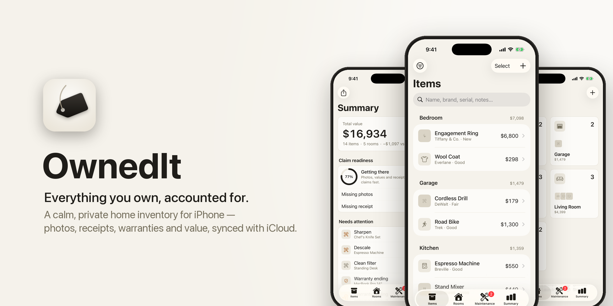
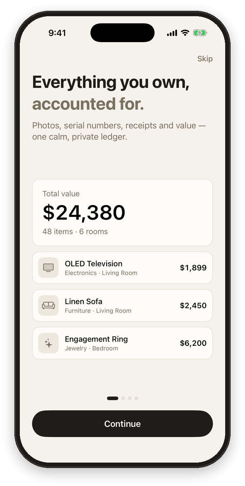
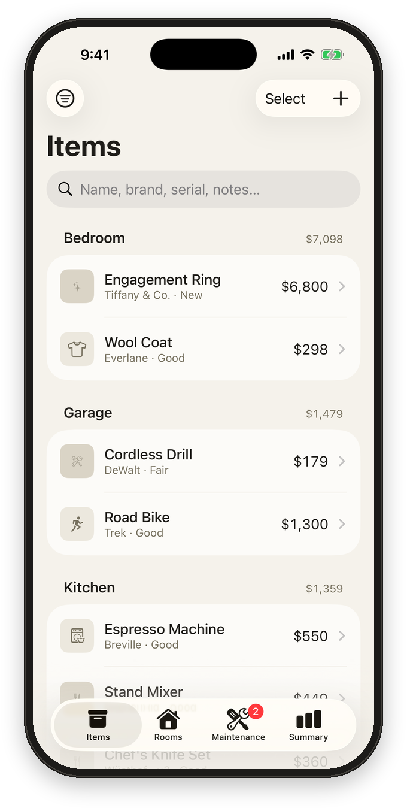
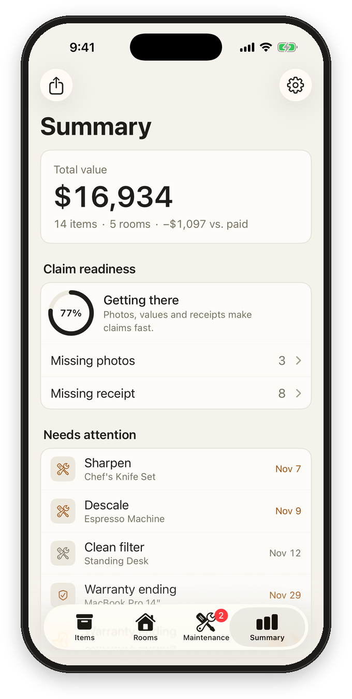
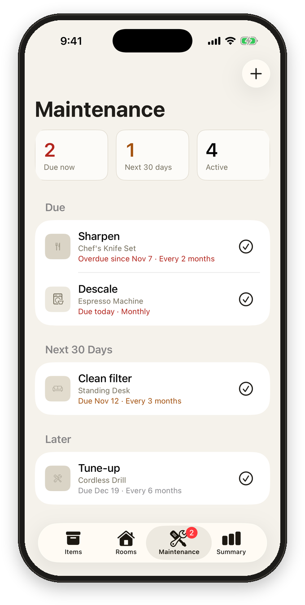
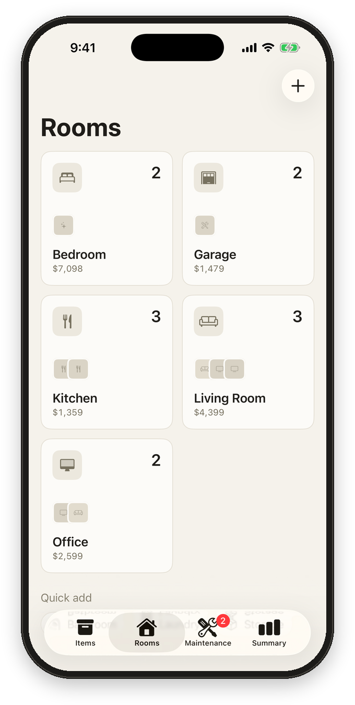
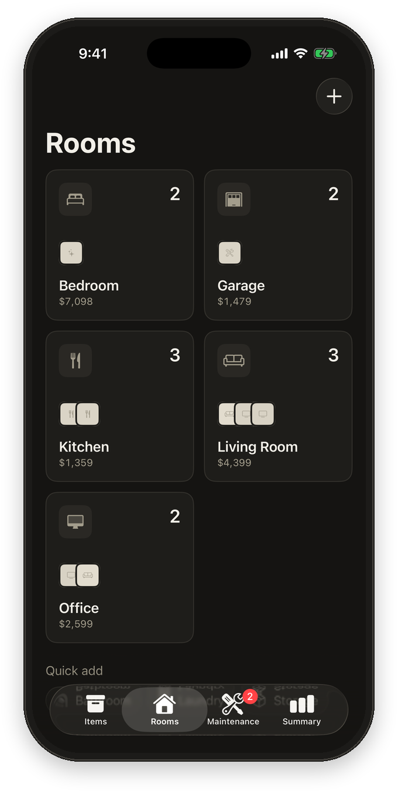
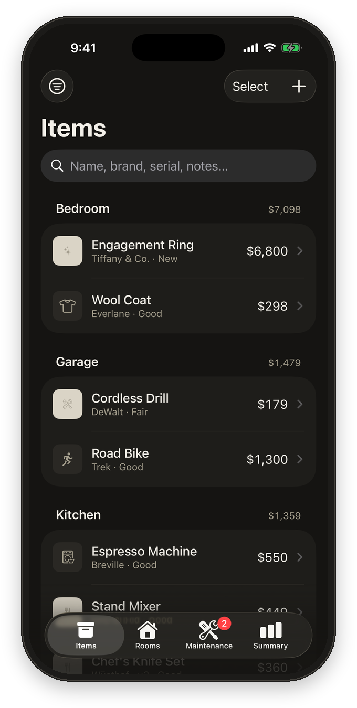
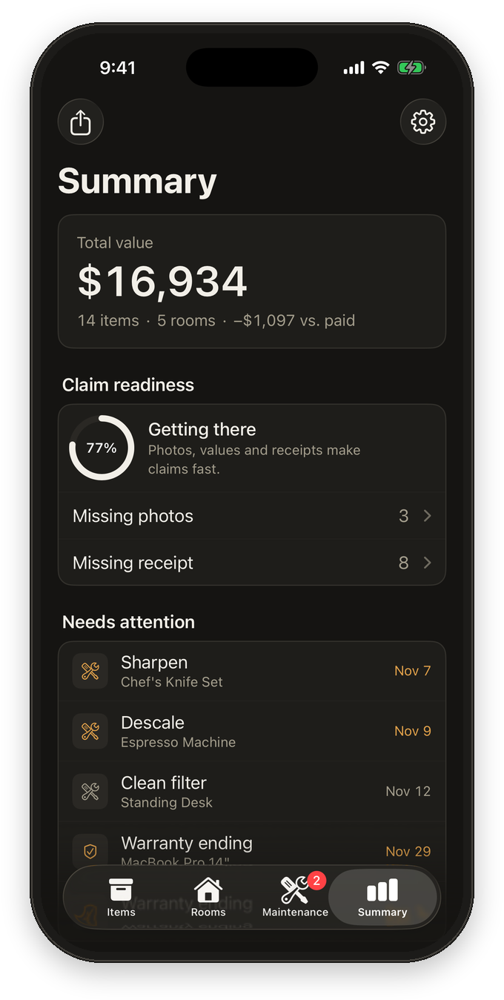

<picture>
  <source media="(prefers-color-scheme: dark)" srcset="docs/images/hero-dark.png">
  
</picture>

  
  
  
  
  

  A home inventory app for iPhone. Track what you own, where it lives, what it's worth, 
  and when warranties expire, so an insurance claim takes minutes, not weekends.

 

  
  
  
  

## What it does

| | |
|---|---|
| 📦 **Items** | Photos (camera or library, reorderable, with a cover photo), purchase info, serial number, condition, current value, warranty, notes, and attached receipts and documents. Scan a **barcode** to fill in the name, brand, model and a product photo, or **scan a paper receipt** straight to PDF. |
| 🏠 **Rooms** | Organize items by where they live, with per-room totals. |
| 🔧 **Maintenance** | Recurring reminders (filters, servicing, batteries) with local notifications, pause/resume and completion history. |
| 📊 **Summary** | Total value, a **claim readiness** score that shows which items are missing photos, values or receipts, plus warranty and maintenance alerts and breakdowns by category and room. |
| 📄 **Export & import** | A PDF inventory report grouped by room, and per-item PDF records for insurance. CSV export and import that round-trips across devices and accepts most spreadsheets with a "Name" column. |
| ☁️ **Sync** | iCloud (CloudKit) sync across your devices. Notifications are derived from the synced data, so a reminder created on one device alerts on all of them. |

## Light and dark

  
  
  
  

## Design

The look is calm and editorial, like a well-kept paper ledger:

- **Warm paper** background, with cards that have hairline borders instead of shadows.
- **Ink is the only accent.** Amber and red appear only as warnings.
- **One typeface:** SF Pro everywhere, with tabular digits for money. Size and weight set the hierarchy.
- **One icon style:** neutral rounded tiles, or the item's own photo.
- **Motion** is short and purposeful (critically damped springs, subtle press feedback) and respects Reduce Motion.

Shared tokens and components live in [`Theme.swift`](OwnedIt/Theme.swift).

## Tech

- **SwiftUI + SwiftData**, backed by CloudKit with a local-only fallback
- **VisionKit** for barcode and document scanning
- **PhotosUI** and the camera for photos (downscaled to 2048 px, with cached thumbnails)
- **UserNotifications** for reminders and warranty alerts
- **UIGraphicsPDFRenderer** for reports

## Running it

Open `OwnedIt.xcodeproj` in Xcode 16+ and run. There are no external dependencies.

Debug builds accept a few launch arguments:

| Argument | Effect |
|---|---|
| `-seedSampleData YES` | Fills an empty store with demo items, rooms and reminders |
| `-initialTab items\|rooms\|maintenance\|summary` | Opens straight to that tab |
| `-hasSeenOnboarding YES` | Skips onboarding |

The README images are generated: [`Tools/make_readme_art.py`](Tools/make_readme_art.py) frames simulator screenshots and draws the banner, and [`Tools/make_app_icon.py`](Tools/make_app_icon.py) draws the app icon.

## License

MIT
